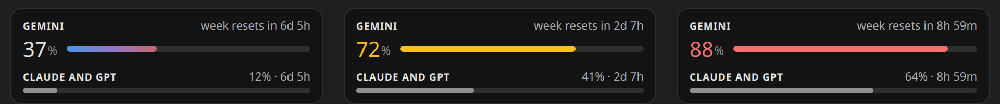

# Gemini Usage for VS Code

Your Google AI plan's weekly limits in Antigravity CLI, in a small card in the VS Code sidebar: the Gemini models'
week as a number and a bar, and the Claude and GPT-OSS models' week as a thin row, each with the time until it resets.
It was made to sit beside [ChatGPT Usage](https://github.com/LaineyLouiseWard/chatgpt-usage-vscode) and
[Clawd Usage](https://github.com/LaineyLouiseWard/clawd-usage-vscode), and works on its own.

Unofficial project, not made by or affiliated with Google.

## What it shows

- The share of the Gemini week used, as a number and a bar, and the time until it resets. The number turns yellow at
  60% and red at 85%.
- Every other quota group the plan reports (today: Claude and GPT-OSS), with its share used and reset time.

## Install

You need [Antigravity CLI](https://github.com/google-antigravity/antigravity-cli) (`agy`), signed in once with a
personal Google account on a Google AI plan.

1. Download `gemini-usage-<version>.vsix` from the [releases page](https://github.com/LaineyLouiseWard/gemini-usage-vscode/releases).
2. Run `code --install-extension gemini-usage-<version>.vsix`, or in VS Code open the Extensions view, click its `…` menu and
   choose *Install from VSIX…*.
3. Open the Explorer. Gemini Usage is a section at the bottom. Right-click any section header to show or hide it, or
   drag it into the bottom panel.

Settings live under *Gemini Usage* in VS Code's settings: the refresh interval, the yellow and red levels, and the
path to `agy`.

## How it gets the numbers

Every 5 minutes it runs `agy -p /usage --output-format json`, which reads the plan's quotas and calls no model, so it
uses none of your limits. It uses the `agy` on your PATH, then `~/.local/bin/agy`, or the path in the
`geminiUsage.agyPath` setting.

## Structure

- `extension.js` runs inside VS Code. It finds `agy`, reads the limits and runs the view.
- `media/main.js` and `media/style.css` draw the card.
- `test/test.js` runs the extension against a fake `vscode` module and the real `agy`: `node test/test.js`.

It is plain JavaScript and runs as written. To package it, run `npx @vscode/vsce package`.

## Related

- [Clawd Usage for VS Code](https://github.com/LaineyLouiseWard/clawd-usage-vscode): Claude plan usage with Clawd the crab.
- [ChatGPT Usage for VS Code](https://github.com/LaineyLouiseWard/chatgpt-usage-vscode): your ChatGPT plan's Codex limits.
- [Clawd Usage for Linux](https://github.com/LaineyLouiseWard/clawd-usage-linux): Clawd as a desktop widget.

## Licence

MIT. See [LICENSE](LICENSE).
